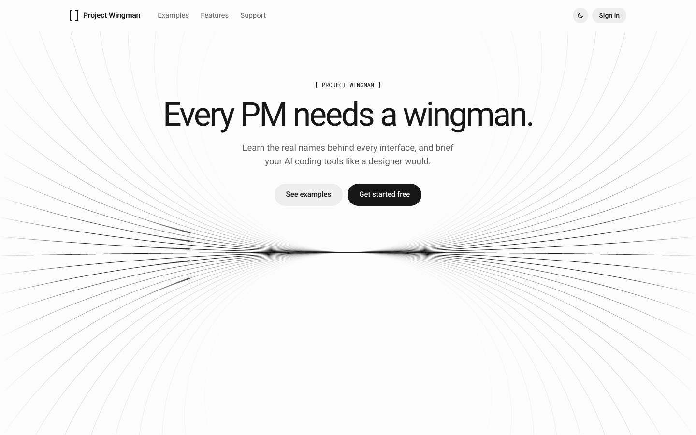
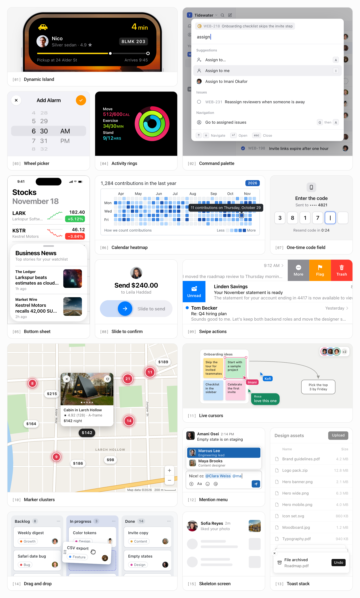
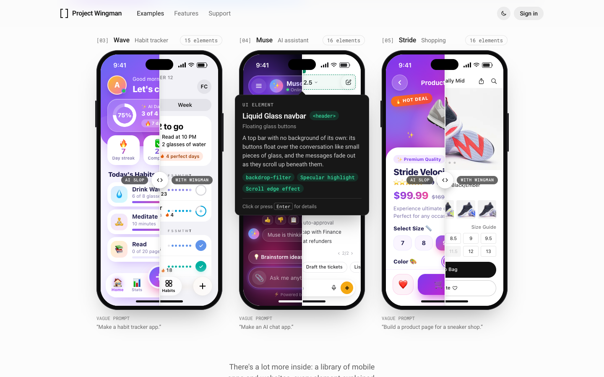
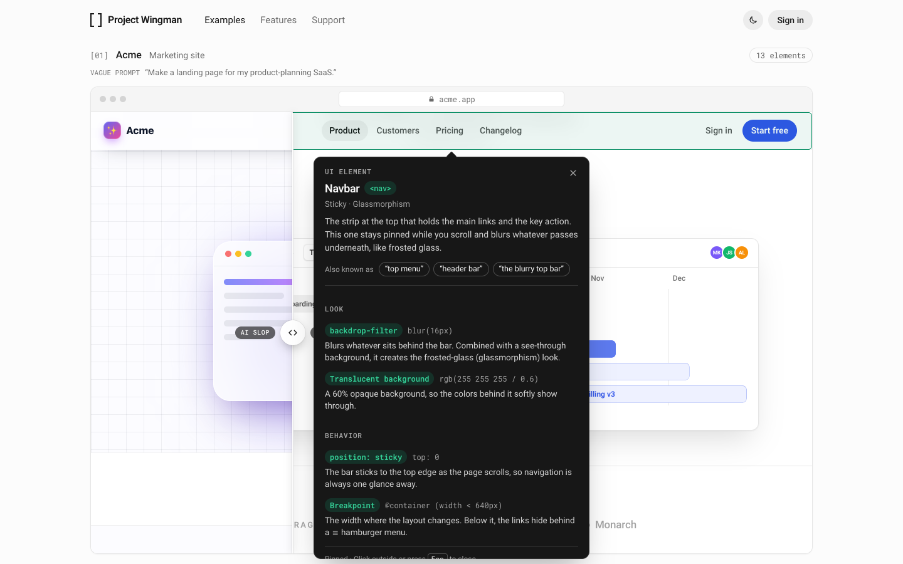
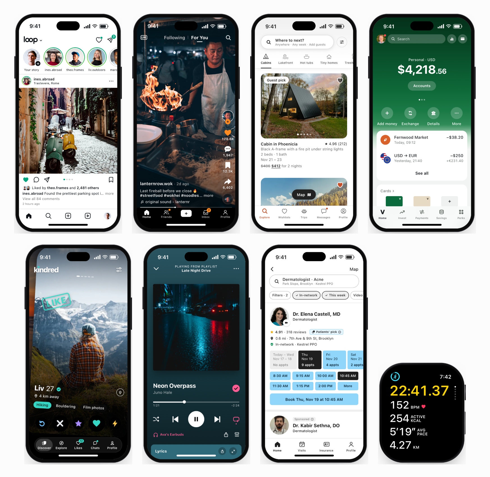
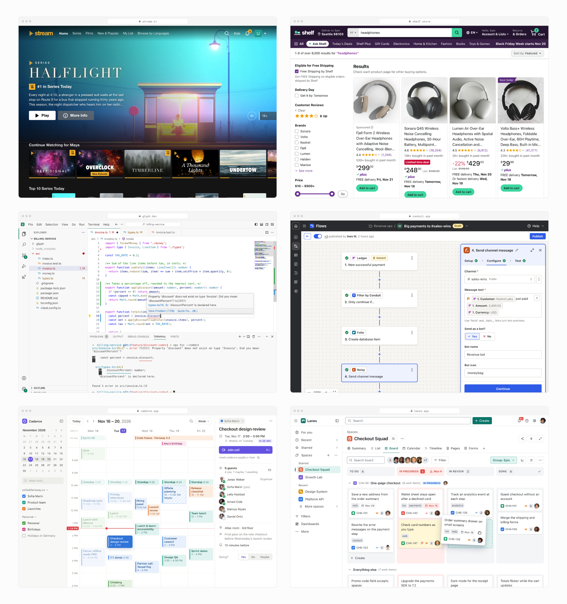

# Project Wingman

<picture>
  <source media="(prefers-color-scheme: dark)" srcset="docs/screenshots/hero-dark.png">
  
</picture>

**The PM's best friend for design.** Project Wingman teaches product managers and founders the real names behind
interface elements, and turns the ones you pick into a design brief that AI coding tools such as Claude Code and Cursor
understand. Next, it will write that brief from everyday descriptions like “the top menu with the blurry background”.

## A look inside

Right under the hero, a gallery runs fifteen elements from apps people use every day, each working the way it does
there: the Dynamic Island, a command palette, live cursors, marker clusters, a toast stack and more. Every part of each
one can be inspected:

<picture>
  <source media="(prefers-color-scheme: dark)" srcset="docs/screenshots/gallery-dark.png">
  
</picture>

Each example further down is a before/after: drag the line to compare the AI slop a vague prompt produces with the
same product built from a Wingman brief. Hover anything on either side to learn what it's called. Click to pin the
full explanation: how it looks, how it behaves, and the exact CSS behind it. The examples switch to dark mode with the
page (products that are dark by design stay dark), and the balloons show the values for the theme you're in.

<picture>
  <source media="(prefers-color-scheme: dark)" srcset="docs/screenshots/phones-dark.png">
  
</picture>

### The library

Behind sign-in, the library holds more than thirty apps, sites and watch apps, each modeled on a product people use
every day: the same layout and component shapes, with its own name, colors, copy and real photos. Every element can be
inspected the same way and added to a brief. Here Lanes, a board in the style of Jira, explains its WIP limit:

<picture>
  <source media="(prefers-color-scheme: dark)" srcset="docs/screenshots/inspect-dark.png">
  
</picture>

Apps for the phone and the watch:

<picture>
  <source media="(prefers-color-scheme: dark)" srcset="docs/screenshots/library-apps-dark.png">
  
</picture>

And websites:

<picture>
  <source media="(prefers-color-scheme: dark)" srcset="docs/screenshots/library-sites-dark.png">
  
</picture>

## Current status: landing page, sign-in, the library and the brief

An English landing page with a sticky header (with a theme toggle), a hero, an element gallery, examples, feature cards,
a support section and a footer. Right under the hero, the gallery runs fifteen elements people meet in apps every day
but rarely know the names of (the Dynamic Island, a command palette, live cursors, marker clusters, a toast stack and
more), each live in a tile of a bento grid with its name under it and every part of it inspectable. The examples section
has five projects (a marketing site, an analytics dashboard and three mobile apps), each a before/after comparison with
a line to drag: on the left, the AI slop a vague prompt produces; on the right, the same product built from a Wingman
brief. On both sides nearly every element shows its name on hover, a summary after a two-second pause and the full
explanation on click; on the slop side, the explanation says what makes it read as AI slop. The Wingman versions move
like real products (charts draw in, payments arrive, the chat answer streams, the product photos slide) and hold still
while you inspect them.

Wingman is free: an account opens the library and the brief builder. People who find it useful can sponsor it on
GitHub (`SPONSOR_HREF` in `src/landing/links.ts`; GitHub Sponsors has to be set up on that account).

Sign-in (`/sign-in`) and sign-up (`/sign-up`) pages lead to the library (`/app/mobile`, `/app/web`, `/app/watch`):
mobile apps, websites and Apple Watch apps in three tabs, each a fictional product built from the patterns of
well-known ones (“inspired by” Spotify, Airbnb, Stripe, Notion, Figma, VS Code and others). Phones and watches can be
inspected right in the grid; every example also has its own page (`/app/<platform>/<id>`) with all of its elements
written out. A search finds examples by name or by
element (“bottom sheet”, “toast”). There's no auth backend yet: email and password sign-in only works with the development
account below, and Google sign-in and sign-ups show a “not connected yet” message.

Any element in the library can go into a brief: choose **Add to brief** in its pinned explanation or in the example's
element list. The brief page (`/app/brief`) adds what you're building and a note per element, and turns it all into
Markdown to copy or download: each element's look and behavior with the terms and values to use, followed by acceptance
criteria. The brief is put together from the element descriptions (no LLM yet) and kept in the browser.

Out of scope for now (later phases): a real auth backend (sign-ups open once it exists) and a real LLM integration
(writing the brief from a plain description).

## Before going live

- [ ] **Remove the dev sign-in account.** Delete `src/auth/devAccount.ts` and `src/auth/DevAccountNote.tsx`, and
      their uses in `session.ts`, `SignInPage.tsx`, `Workspace.tsx` and the end-to-end tests' sign-in
      (`e2e/checks.ts`; search for `TODO(before launch)`). It only works in development builds, but it must not ship.
- [ ] Connect a real auth provider for email and password, Google sign-in and sign-ups (`src/auth/session.ts`).
- [ ] Configure the host to serve `index.html` for app routes (`/sign-in`, `/sign-up`, `/app`).

## Getting started

Requires Node.js 20.19+ or 22.12+

```bash
npm install
npm run dev
```

| Command | What it does |
| --- | --- |
| `npm run dev` | Development server, at http://localhost:5173 by default |
| `npm run build` | Type check + production build (`dist/`) |
| `npm run preview` | Serves the production build locally |
| `npm run typecheck` | TypeScript check only |

To try the signed-in area while developing, sign in with the dev account `fatih123` / `fatih123` (the sign-in page
has a “Fill in” shortcut). It only works with `npm run dev` and must be removed before launch.

### Checks

| Command | What it does |
| --- | --- |
| `npm run check` | Type check, lint, unit tests and the production build, in that order |
| `npm run lint` | ESLint with typescript-eslint and the React Hooks rules |
| `npm test` | Unit tests (Vitest), in a couple of seconds |
| `npm run test:e2e` | End-to-end tests (Playwright on Chromium), in under a minute |

- **Unit tests** sit next to the code (`*.test.ts`): the library registry, every element description (complete, with
  unique ids, and every landing page description in use), the photo credits (each file in a `photos/` folder listed in
  its `CREDITS.md` with its Unsplash link and license) and the brief (the saved items it keeps, the Markdown it writes).
- **End-to-end tests** (`e2e/`) open the landing page, the library's tabs and every example's page at 1440 and 390 px:
  no console errors, nothing focusable or scrollable inside a demo, no sideways scrolling, every `data-inspect` id
  described and every description shown. On the landing page they also move the comparison lines with the keyboard,
  keep each AI slop site within its Wingman site's height, and hover an element through name tag, balloon, pin and
  Esc. They start a dev server on port 5199, or use the one running there; install the browser once with
  `npx playwright install chromium`.

CI (`.github/workflows/ci.yml`) runs them all on every pull request and push to `main`, and keeps the Playwright report
when the end-to-end tests fail. It runs on macOS, where the examples' system fonts are the ones they're designed with;
on Linux they fall back to wider fonts, which changes what the end-to-end tests measure. The checks need Node.js
22.13+. Rules turned down for an intentional pattern are in `eslint.config.js`, each with its reason.
typescript-eslint still needs TypeScript 6's API, so `typescript` is TypeScript 6 and `tsc` is TypeScript 7
(`@typescript/native`), as the TypeScript 7.0 release notes suggest. The scripts call TypeScript 7 by its path, since
both packages offer a `tsc` command and npm may link either one.

## Stack

Vite + React 19 + TypeScript, styled with CSS Modules and CSS custom properties (`src/styles/tokens.css`).
No UI library or Tailwind: the CSS values used in the examples are exactly the ones the balloons explain.
Fonts (Roboto and Roboto Mono, the same as LayerZero) are self-hosted via Fontsource. The theme follows the system
setting (light or dark) and can be switched from the header. All visual decisions are in [DESIGN.md](DESIGN.md).

## Project structure

```
src/
  landing/     Landing page sections: header, theme toggle, hero, element gallery (one file per tile in gallery/),
               examples, feature cards, support, footer
  auth/        Sign-in and sign-up pages, the session store (no backend yet) and the dev account
  workspace/   The signed-in area: the library's tabs, search and grids, and each example's page with its glossary
  brief/       The brief: its store (in localStorage), the Markdown writer, the Add to brief button and the brief page
  library/     The library: types, the registry, and one folder per example (mobile/<id>, web/<id>)
  demos/       The landing page's five examples: AcmeSite, OrbitDashboard, WaveApp, MuseApp, StrideApp (+ StatusBar),
               their motion (motion.ts: entrances, live parts that hold while inspected), and in slop/ the AI slop
               version each one is compared with
  catalog/     Element descriptions (English, typed data) for those five, the gallery's tiles (gallery/, one file per
               family) and elements every phone shares
  inspector/   The “inspect element” layer: InspectSurface, explainer balloon, positioning
  showcase/    Frames and the interaction guide: the browser frame as a scroll scene (useScrollScene), a scalable phone
  brand/       Logo and the hero's animated line art (with the shooting star)
  styles/      Design tokens (light-dark) and global styles
  router.tsx   A tiny client-side router: current path, links, redirects, page titles
  theme.ts     Light/dark theme: read, set, subscribe to changes
e2e/           End-to-end checks (Playwright); unit tests sit next to the code as *.test.ts
docs/
  screenshots/ Images used in this README
```

## Adding a library example

Create a folder; the library picks it up on its own (`import.meta.glob` in `src/library/index.ts`):

```
src/library/<mobile|web|watch>/<id>/
  <Name>.tsx         the demo (a named export)
  <Name>.module.css  its styles
  specs.ts           a UiElementSpec for every data-inspect id the demo uses
  index.ts           export const <id>: LibraryExample = { id, platform, name, kind, category, inspiredBy, … }
```

- **The demo is a picture:** no real links, buttons or inputs (`<a>` without `href`, `<span>`), since it sits inside
  one focusable region. Colors are `light-dark()` pairs so it follows the theme. Anything that moves holds still while
  it's inspected and under reduced motion (`useDemoMotion()` in `src/demos/motion.ts`).
- **Mobile** fills a 280 × 600 phone screen and starts with the shared `<StatusBar />`; reuse the `statusBar` and
  `homeIndicator` specs from `src/catalog`. **Watch** fills a 208 × 248 Apple Watch screen (46 mm). **Web** sets
  `container-type: inline-size` and works from about 340 px to 1150 px wide; it can be taller than the window.
- **Names are fictional;** real products go in `inspiredBy`.
- **Same design type, our own identity:** follow one familiar product's real screen closely (layout, type scale, color
  scheme, component shapes) so people recognize it, with our own name, logo, accent hue, copy and data. No real logos,
  mascots or brand marks.
- **Real photos:** anything that stands for a photo (avatars, video frames, food, places) is a free-license Unsplash
  photo, stored in the example's `photos/` folder and listed in its `CREDITS.md`.

## Adding a UI element

1. Write the description: add a `UiElementSpec` to the example's `specs.ts` (for the landing page's five, the matching
   file in `src/catalog/`; for a gallery tile, its family's file in `src/catalog/gallery/`), with the demo's real CSS
   values in its `value` fields. A color that differs by theme is `{ light, dark }`.
2. Mark it in the demo: add a `data-inspect="<id>"` attribute to the element.

Hover, click, touch, keyboard, outline, balloon, the element counter and the glossary all work automatically. An id
with no description logs a warning to the console during development.

## Interaction model

| Input | Preview (summary) | Pinned (full explanation) | Closes |
| --- | --- | --- | --- |
| Mouse | Hover (the name shows at once), wait 2 s | Click | Click outside, click the same element again, Esc |
| Touch | — | Tap | Tap outside (scrolling doesn't close it) |
| Keyboard | Tab into an example, move with the arrow keys | Enter | Esc, Tab out |
