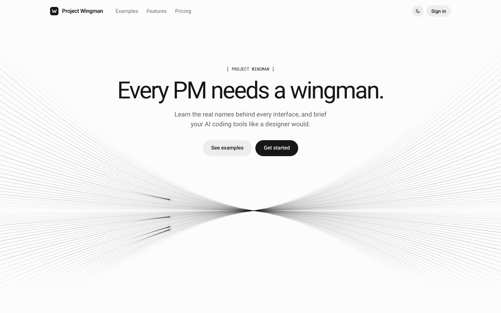
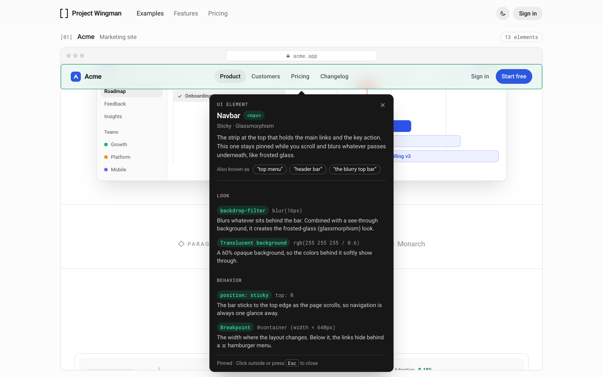
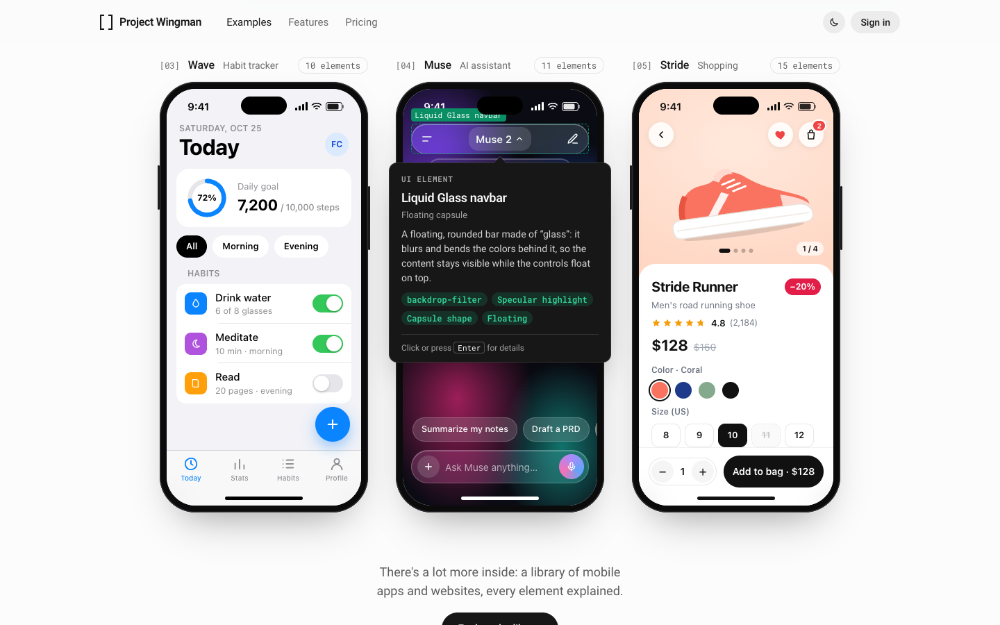

# Project Wingman

<picture>
  <source media="(prefers-color-scheme: dark)" srcset="docs/screenshots/hero-dark.png">
  
</picture>

**The PM's best friend for design.** Project Wingman teaches product managers and founders the real names behind
interface elements, and turns the ones you pick into a design brief that AI coding tools such as Claude Code and Cursor
understand. Next, it will write that brief from everyday descriptions like “the top menu with the blurry background”.

## A look inside

Hover anything in the examples to learn what it's called. Click to pin the full explanation: how it looks, how it
behaves, and the exact CSS behind it. The examples switch to dark mode with the page (Muse is dark by design), and the
balloons show the values for the theme you're in.

<picture>
  <source media="(prefers-color-scheme: dark)" srcset="docs/screenshots/inspect-dark.png">
  
</picture>

Three mobile apps side by side, with a preview of Muse's Liquid Glass navbar:

<picture>
  <source media="(prefers-color-scheme: dark)" srcset="docs/screenshots/phones-dark.png">
  
</picture>

## Current status: landing page, sign-in, the library and the brief

An English landing page with a sticky header (with a theme toggle), a hero, examples, feature cards, pricing and a
footer. The examples section has five projects (a marketing site, an analytics dashboard and three mobile apps), and
nearly every element shows its name on hover, a summary after a short pause and the full explanation on click.

Sign-in (`/sign-in`) and sign-up (`/sign-up`) pages lead to the library (`/app/mobile`, `/app/web`): mobile apps and
websites in two tabs, each a fictional product built from the patterns of well-known ones (“inspired by” Spotify,
Airbnb, Stripe, Linear and others). Phones can be inspected right in the grid; every example also has its own page
(`/app/<platform>/<id>`) with all of its elements written out. A search finds examples by name or by element
(“bottom sheet”, “toast”). There's no auth backend yet: email and password sign-in only works with the development
account below, and Google sign-in and sign-ups show a “not connected yet” message.

Any element in the library can go into a brief: choose **Add to brief** in its pinned explanation or in the example's
element list. The brief page (`/app/brief`) adds what you're building and a note per element, and turns it all into
Markdown to copy or download: each element's look and behavior with the terms and values to use, followed by acceptance
criteria. The brief is put together from the element descriptions (no LLM yet) and kept in the browser.

Out of scope for now (later phases): a real auth backend, payments and subscriptions (plan prices are placeholders),
and a real LLM integration (writing the brief from a plain description).

## Before going live

- [ ] **Remove the dev sign-in account.** Delete `src/auth/devAccount.ts` and `src/auth/DevAccountNote.tsx`, and
      their uses in `session.ts`, `SignInPage.tsx` and `Workspace.tsx` (search for `TODO(before launch)`). It only
      works in development builds, but it must not ship.
- [ ] Connect a real auth provider for email and password, Google sign-in and sign-ups (`src/auth/session.ts`).
- [ ] Configure the host to serve `index.html` for app routes (`/sign-in`, `/sign-up`, `/app`).

## Getting started

Requires Node.js 20.19+ or 22.12+

```bash
npm install
npm run dev
```

| Command | What it does |
| --- | --- |
| `npm run dev` | Development server, at http://localhost:5173 by default |
| `npm run build` | Type check + production build (`dist/`) |
| `npm run preview` | Serves the production build locally |
| `npm run typecheck` | TypeScript check only |

To try the signed-in area while developing, sign in with the dev account `fatih123` / `fatih123` (the sign-in page
has a “Fill in” shortcut). It only works with `npm run dev` and must be removed before launch.

## Stack

Vite + React 19 + TypeScript, styled with CSS Modules and CSS custom properties (`src/styles/tokens.css`).
No UI library or Tailwind: the CSS values used in the examples are exactly the ones the balloons explain.
Fonts (Roboto and Roboto Mono, the same as LayerZero) are self-hosted via Fontsource. The theme follows the system
setting (light or dark) and can be switched from the header. All visual decisions are in [DESIGN.md](DESIGN.md).

## Project structure

```
src/
  landing/     Landing page sections: header, theme toggle, hero, examples, feature cards, pricing, footer
  auth/        Sign-in and sign-up pages, the session store (no backend yet) and the dev account
  workspace/   The signed-in area: the library's tabs, search and grids, and each example's page with its glossary
  brief/       The brief: its store (in localStorage), the Markdown writer, the Add to brief button and the brief page
  library/     The library: types, the registry, and one folder per example (mobile/<id>, web/<id>)
  demos/       The landing page's five examples: AcmeSite, OrbitDashboard, WaveApp, MuseApp, StrideApp (+ StatusBar)
  catalog/     Element descriptions (English, typed data) for those five, plus elements every phone shares
  inspector/   The “inspect element” layer: InspectSurface, explainer balloon, positioning
  showcase/    Frames and the interaction guide: the browser frame as a scroll scene (useScrollScene), a scalable phone
  brand/       Logo and the hero's animated line art (with the shooting star)
  styles/      Design tokens (light-dark) and global styles
  router.tsx   A tiny client-side router: current path, links, redirects, page titles
  theme.ts     Light/dark theme: read, set, subscribe to changes
docs/
  screenshots/ Images used in this README
```

## Adding a library example

Create a folder; the library picks it up on its own (`import.meta.glob` in `src/library/index.ts`):

```
src/library/<mobile|web>/<id>/
  <Name>.tsx         the demo (a named export)
  <Name>.module.css  its styles
  specs.ts           a UiElementSpec for every data-inspect id the demo uses
  index.ts           export const <id>: LibraryExample = { id, platform, name, kind, category, inspiredBy, … }
```

- **The demo is a picture:** no real links, buttons or inputs (`<a>` without `href`, `<span>`), since it sits inside
  one focusable region. Colors are `light-dark()` pairs so it follows the theme. Anything that moves on its own
  pauses while inspected (`useInspectActivity()`).
- **Mobile** fills a 280 × 600 phone screen and starts with the shared `<StatusBar />`; reuse the `statusBar` and
  `homeIndicator` specs from `src/catalog`. **Web** sets `container-type: inline-size` and works from about 340 px to
  1150 px wide; it can be taller than the window.
- **Names are fictional;** real products go in `inspiredBy`.

## Adding a UI element

1. Write the description: add a `UiElementSpec` to the example's `specs.ts` (for the landing page's five, the
   matching file in `src/catalog/`), with the demo's real CSS values in its `value` fields. A color that differs by
   theme is `{ light, dark }`.
2. Mark it in the demo: add a `data-inspect="<id>"` attribute to the element.

Hover, click, touch, keyboard, outline, balloon, the element counter and the glossary all work automatically. An id
with no description logs a warning to the console during development.

## Interaction model

| Input | Preview (summary) | Pinned (full explanation) | Closes |
| --- | --- | --- | --- |
| Mouse | Hover, wait 280 ms | Click | Click outside, click the same element again, Esc |
| Touch | — | Tap | Tap outside (scrolling doesn't close it) |
| Keyboard | Tab into an example, move with the arrow keys | Enter | Esc, Tab out |
